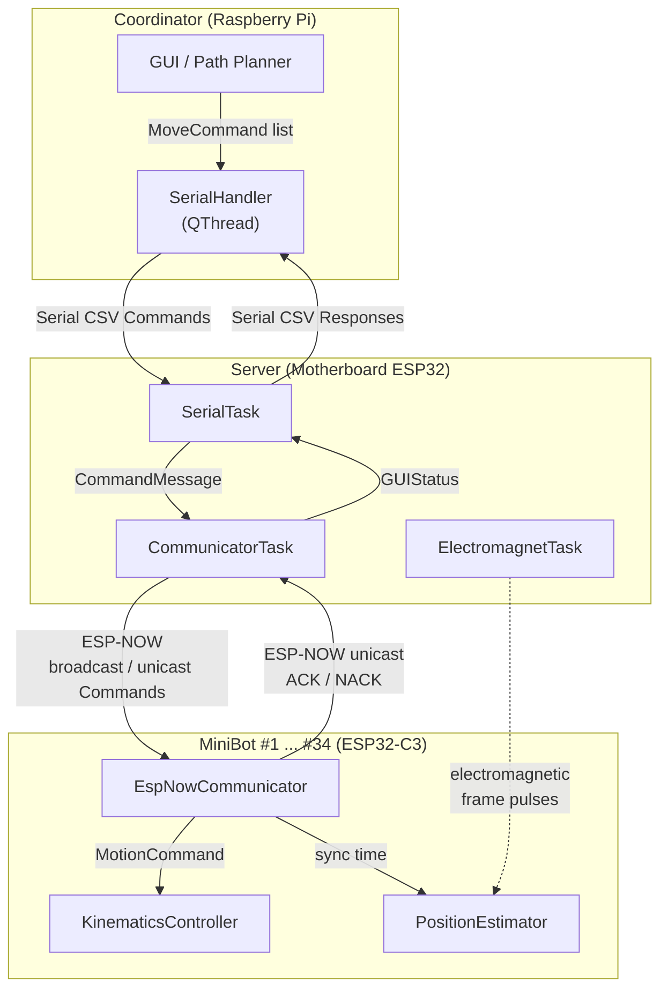

# MiniBot

A swarm robotics platform built around autonomous chess. The system runs 34 small
differential-drive robots across an 8x8 board, each independently localized and
coordinated by a central Python application running on a Raspberry Pi.

The design is general-purpose — chess is the primary use case, but the platform
works for any scenario requiring coordinated movement of many small autonomous
robots in a bounded space.

Per-bot hardware cost is approximately $4 excluding PCB.

---

## Table of Contents

1. [System Architecture](#system-architecture)
2. [Hardware](#hardware)
3. [Communication Pathways](#communication-pathways)
4. [Server-Bot Sync](#server-bot-sync)
5. [Localization](#localization)
6. [Fleet Firmware Updates (OTA)](#fleet-firmware-updates-ota)
7. [PCB and CAD](#pcb-and-cad)
8. [Firmware](#firmware)

---

## System Architecture

The system has three layers:

**Coordinator** is a Python/PyQt6 application running on a Raspberry Pi. It holds
board state, runs path planning, drives the GUI, and sends motion commands to the
Server over USB serial.

**Server** is an ESP32 on the motherboard. It acts as a wireless gateway: it receives
CSV commands from the Coordinator over USB serial, translates them to binary ESP-NOW
messages, and broadcasts them to the bots. It also drives the electromagnets used for
localization and collects ACK/NACK responses back up to the Coordinator.

**MiniBots** are the robots themselves. Each runs an ESP32-C3 with six concurrent
FreeRTOS tasks handling motion control, wireless communication, position estimation,
battery management, and over-the-air firmware updates entirely onboard.

---

## Hardware

### MiniBot

| Component | Details |
|-----------|---------|
| MCU | ESP32-C3 (RISC-V, 2.4 GHz WiFi) |
| Motors | 2x PMO8-2 miniature stepper motors |
| Motor drivers | STSPIN220 |
| Magnetometer | MMC5633NJL (I2C) |
| Power | ~170 mAh LiPo |
| Chassis | Fully 3D printed; 2x M2x5mm bolts, 2x 7mm ID o-rings for tires |
| PCB | Custom 4-layer; fits in the base of the chassis |

### Server / Motherboard

| Component | Details |
|-----------|---------|
| MCU | ESP32-C3 (RISC-V, 2.4 GHz WiFi) |
| Electromagnets | Multiple, positioned at fixed known coordinates on the board |
| Interface | USB serial to Raspberry Pi |
| WiFi | Soft AP; bots connect on a dedicated channel |

The electromagnets fire in a timed sequence that the MiniBots detect with their
onboard magnetometers. This is the primary localization mechanism.

---

## Communication Pathways

### CSV Protocol (Host to Server)

All messages are prefixed with `>`. The Server parses these and forwards the
appropriate ESP-NOW message to the targeted bot(s).

| Type | Direction | Format |
|------|-----------|--------|
| 0 | Host to ESP32 | `>0,{id},{mode},{duty1},{duty2}` -- motor test |
| 1 | Host to ESP32 | `>1,{id},{x},{y},{theta_rad},{duration_ms}` -- position command |
| 2 | Host to ESP32 | `>2,{id}` -- position request |
| 3 | ESP32 to Host | `>3,{id},{x},{y},{theta_rad},{timestamp_ms},{battery_v}` -- ACK |
| 4 | ESP32 to Host | `>4,{id},{err_type},{timestamp_ms}` -- NACK |
| 5 | Host to ESP32 | `>5,{id}` -- mag field request |
| 6 | ESP32 to Host | `>6,{id},{bx},{by},{bz},{timestamp_ms}` -- mag field response |
| 7 | Host to ESP32 | `>7` -- sync broadcast |
| 254 | Host to ESP32 | `>254,{0 or 1}` -- electromagnet enable/disable |
| 255 | Both | `>255` -- ping/pong |

Theta is transmitted in radians on the wire. The Coordinator converts internally;
all application-level code uses degrees.

### ESP-NOW Protocol (Server to MiniBots)

Binary packed structs defined in `ESPNowMessages.h` (Server) and
`messages_espnow.h` (MiniBot). Key message types: `PositionCommand`,
`MotTestCommand`, `PositionRequest`, `PosSync`, `AckMessage`, `NackMessage`,
`MagneticFieldRequest`, `MagneticFieldResponse`.

---

## Server-Bot Sync

Before a localization measurement can be taken, every MiniBot needs to know
precisely when the electromagnet frame will begin so it can timestamp its
magnetometer samples against a common reference.

**Initiating a sync** is triggered by the Coordinator sending a `>7` sync command.
The Server's `CommunicatorTask` handles it as follows:

1. A `PosSyncCommand` is broadcast to all bots. The message includes a timeout
   indicating how long the bots should stay awake listening for the frame.
2. After a short delay, the Server sends a rapid burst of `PosSync` pulses. Each
   carries a `next_frame_us` field indicating how many microseconds until the
   electromagnet frame starts.
3. The `ElectromagnetTask` fires the frame immediately after the burst completes.

**On each MiniBot**, when `PosSyncCommand` is received, `EspNowCommunicator` sets
a deadline and raises `waiting_for_pos_sync`. The ESP-NOW receive callback captures
a high-resolution timestamp the instant each `PosSync` pulse arrives, before any
further processing. The task keeps only the earliest-arriving pulse from the burst —
minimum latency gives the best timing accuracy. The estimated frame start is
`receive_time + next_frame_us` from that best pulse.

Once the deadline passes, the bot calls `PositionEstimator_SetSyncTime()` with the
estimated frame-start, then sends an ACK with a small random delay to spread
simultaneous responses from many bots. If no pulse arrived in time, it sends
`ERR_SYNC_TIMEOUT`.

**Radio duty cycling** is tied to sync health. After a successful sync, each bot
enables duty cycling to save power. If sync becomes stale, the radio reverts to
always-on so the Server can reach the bot to re-establish sync.

---

## Localization

The Server fires each electromagnet in sequence as part of a repeating frame. Each
slot has a brief forward and reverse pulse to produce a detectable field, with a
known timing offset between slots.

On each MiniBot, `PositionEstimator_SensorTask` reads the magnetometer
continuously. Once a valid sync time is set, it timestamps each sample relative to
the frame start and assigns samples to their electromagnet slot by timing alone.

Once a complete frame is collected, `PositionEstimator_CalcTask` performs
trilateration using the field strength readings from the closest electromagnets and
their known board positions. This yields an (x, y, orientation) estimate with a
confidence score, which is used to weight a low-pass filter before the result is
committed to the robot's true pose via `robot.setTruePose()`.

---

## Fleet Firmware Updates (OTA)

A firmware image is staged once on the Server and pushed out to a selected set of bots, so a
fleet update never requires reflashing a bot by hand. The OTA tab (`gui/tabs/ota_update_tab.py`)
owns selection and the per-bot status display; `comms/ota_manager.py` owns the wire protocol and
the rollout schedule; LittleFS staging lives in the Server's `SerialTask`.

**Staging.** The Coordinator reads the selected `.bin`, computes a CRC-32, and sends
`>200,{size},{crc32}`. The Server drops any previously staged image, refuses the request if the
image does not fit the free LittleFS space, and replies `>200,READY`. The Coordinator then streams
the raw bytes onto the bulk transfer queue. The Server writes them while checksumming on the fly,
and answers `>200,OK` only if every write was accepted in full and the file on disk has both the
expected length and the expected checksum. Any other outcome aborts the upload, deletes the
partial file, and reports `>200,ERR,{reason}` - a truncated image is never quietly accepted.

**Rollout.** Bots are updated one at a time (`OTA.MAX_PARALLEL_UPDATES`). Each request
`>201,{id},{version}` queues an `OtaCommand` carrying the staged image's size and CRC; those two
values are sent only while they still describe the file on storage, so an aborted upload
invalidates them and a reboot re-derives them by checksumming whatever is on LittleFS. The Server
replies `>203,{id}` once the command is queued, and that is the point the Coordinator marks the
bot active - a request that never gets an ack leaves the bot pending rather than showing a false
success. Precondition and queue failures return as ordinary `>4` NACKs and fail that bot
immediately instead of waiting out the result timeout.

**On the bot.** `ota_updater.cpp` runs as its own FreeRTOS task. It joins the Server's WiFi AP
(the same network used for the ESP-NOW gateway), downloads `GET /firmware.bin` from the Server's
web handler, checks size and CRC-32 against the `OtaCommand`, and hands the image to the ESP OTA
API. The version stamp sent with the command is the image CRC; each bot keeps its running version
in NVS, so an image that bot already runs reports `ALREADY_CURRENT` and is not reflashed.

**Flash layout.** Both firmware projects carry their own partition tables, and the bots are the
ones that care. `firmware/MiniBot_StepperClient/partitions.csv` gives a bot two app slots -
`factory` and `recovery`, both `app`, `0xF0000` (960 KiB) each, auto-placed by esptool after the
bootloader at the `0x8000` table offset. Two slots are what let `ota_updater.cpp` call
`Update.begin(cmd.fw_size)` with no partition index: the ESP OTA API always writes the slot that
is not the running one, so an update never overwrites the image the fleet is currently using.
`main.cpp` then calls `esp_ota_mark_app_valid_cancel_rollback()` at boot to accept the new image,
and an image that fails to boot rolls back to the previous slot on the following reset instead of
leaving the bot unusable. A staged image therefore has to fit a single 960 KiB slot - the latest
build is 1,011,760 bytes, so re-check the sizing against the newest image. If the espressif32 core
does not pick the csv up, the default single `factory` slot leaves nowhere to write and
`Update.begin()` reports "partition not found"; fix it with one reflash of the layout
(`esptool.py --partition-table=partitions.csv --partition-table-offset=0x8000 partition-table`,
the note in `platformio.ini`). The Server needs no csv: the staged image is a LittleFS file
(`board_build.filesystem = littlefs`), and staging is refused when the free LittleFS bytes cannot
hold the image plus `OTA_STAGING_HEADROOM_BYTES` (2 KiB). Bots keep the running version stamp and
the device ID in NVS, and that table has no `nvs` line while `ensure_nvs_initialized()` ignores
init failures, so confirm NVS has a partition on hardware before trusting the `ALREADY_CURRENT`
short-circuit.

**Reporting.** The bot does not ACK the `OtaCommand`. It sends an ESP-NOW `OtaResult`, then
reboots onto the new firmware; the Server prints the outcome back up to the Coordinator as
`>202,{id},{success},{err_code},{version}`.

| Type | Direction | Format |
|------|-----------|--------|
| 200 | Host to ESP32 | `>200,{size},{crc32}` - stage an image, then raw bytes |
| 200 | ESP32 to Host | `>200,READY` / `>200,OK` / `>200,ERR,{reason}` |
| 201 | Host to ESP32 | `>201,{id},{version}` - broadcast the staged image |
| 203 | ESP32 to Host | `>203,{id}` - the `>201` was queued |
| 202 | ESP32 to Host | `>202,{id},{success},{err_code},{version}` - bot result |

ESP-NOW is fire-and-forget, so the `>202` result is the only definitive confirmation that a bot
updated; the Coordinator applies a per-bot `OTA.RESULT_TIMEOUT_S` and reports a timeout when none
arrives. If the serial link to the Server goes down, any upload or rollout in flight is failed
outright rather than left waiting on bots that can no longer be reached.

---

## PCB and CAD

Current board designs are in `pcbs/`:

- `pcbs/MiniBot_MainBoard/` -- MiniBot PCB (ESP32-C3, stepper drivers, magnetometer, LiPo charger)
- `pcbs/Server_Motherboard/` -- Motherboard (ESP32-C3, electromagnet drivers, connectors)

Gerber files are in the `GERBERS/` subdirectory of each board folder.

CAD (OnShape):
https://cad.onshape.com/documents/4f8eaef75458146767928ab5/w/f159d6d65b9091531e1ead34/e/13b51722310f27710438c727

---

## Firmware

Each firmware project has its own README with task breakdowns, key objects, and
build instructions.

- `firmware/MiniBot_Coordinator/` -- Python/PyQt6 host application
- `firmware/MiniBot_Server/` -- ESP32 motherboard firmware (PlatformIO)
- `firmware/MiniBot_StepperClient/` -- ESP32-C3 per-bot firmware (PlatformIO)